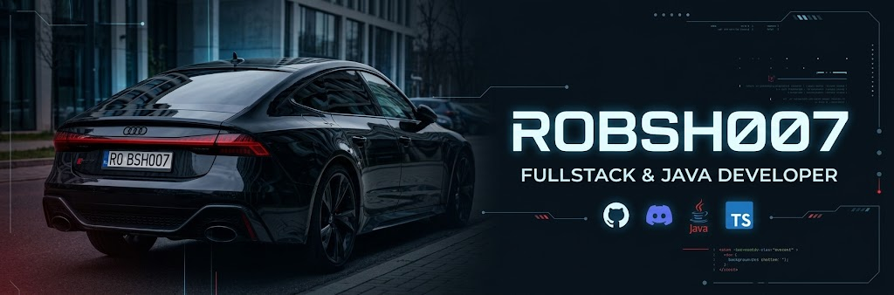

# ROBSH007

<!-- Baner z autem na samej górze -->

### Fullstack / Java Developer

*Tworzę projekty w Java i TypeScript.*

`FullStack` • `Automations` • `TypeScript` • `Java`

---

### 📊 Statystyki

